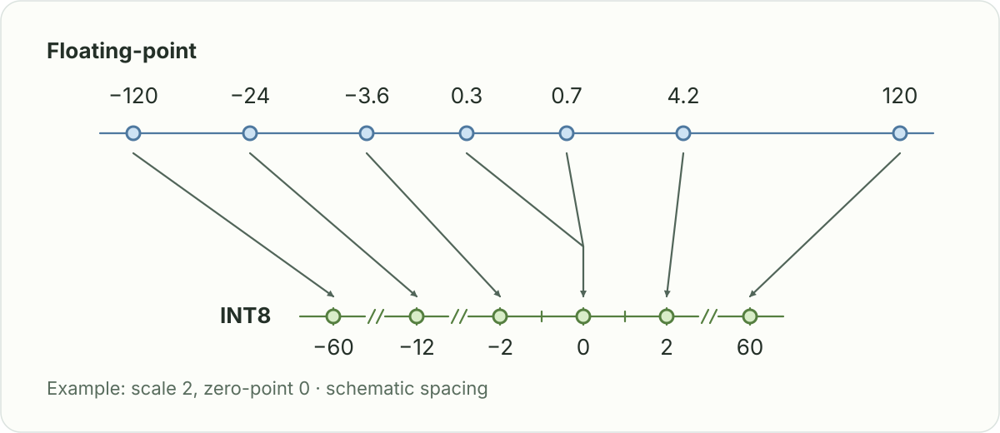
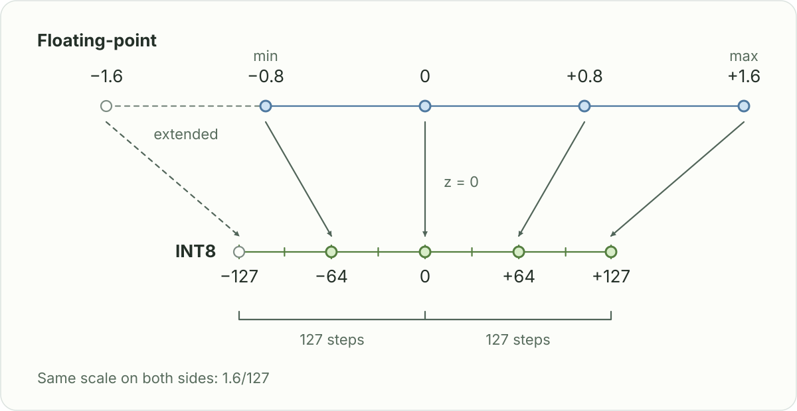

# Chapter 1: Post-training Quantization

Quantization represents numerical values with fewer bits. For a large language model, reducing the precision of weights can lower model storage and memory traffic during inference. Some quantization schemes also reduce the precision of activations. The resulting speed depends on the hardware and kernels used to execute the quantized model.

**Post-training quantization (PTQ) quantizes a model after it has been trained.** It starts from an existing checkpoint rather than requiring a full training run with quantization in the loop.



Each floating-point value is divided by the shared scale of **2** and rounded to the nearest integer on the INT8 line. Different inputs can share a code: **0.3 and 0.7 both become 0**, so some precision is lost. Multiplying the code by the scale reconstructs an approximate floating-point value.

## 1. Linear Symmetric Quantization

This implementation uses **one scale for the whole tensor** and zero-point $z=0$.



The data spans **−0.8 to 1.6**, so the largest absolute value is **1.6**. **Symmetric** quantization uses **−1.6 to 1.6**, centered on zero. The dashed part extends the range beyond the observed data. Both sides use the same scale, and zero maps to zero.

### From weights to integers

For a nonempty tensor of finite weights $X$, compute the scale $s$:

$$
a = \max_{x\in X}|x|.
$$

$$
s = \begin{cases}
a/127, & a > 0, \\
1, & a = 0.
\end{cases}
$$

Then quantize each weight $x$ and reconstruct its approximation $\hat{x}$:

$$
q = \operatorname{clip}\!\left(\operatorname{round}_{\mathrm{even}}(x/s), -127, 127\right).
$$

$$
\hat{x} = s q.
$$

The range $[-127,127]$ is symmetric around zero, leaving INT8's $-128$ unused.

### Reconstruction error

Adjacent reconstruction levels are $s$ apart. Within range, rounding introduces at most half a step of error in exact arithmetic:

$$
|\hat{x}-x| \leq \frac{s}{2} \approx 0.003937
\quad\text{for this example}.
$$

The code below uses $s=1/127$ because the largest absolute weight is $1$.

### NumPy implementation

```python
import numpy as np

np.set_printoptions(precision=6, suppress=True)


def quantize_symmetric_int8(x):
    """Quantize a tensor to INT8 using per-tensor symmetric quantization."""
    x = np.asarray(x, dtype=np.float32)

    max_abs = float(np.max(np.abs(x)))

    # Avoid division by zero for an all-zero tensor.
    scale = max_abs / 127.0 if max_abs > 0 else 1.0

    # Use [-127, 127] for a strictly symmetric integer range.
    # The zero-point is 0.
    q = np.clip(
        np.rint(x / scale), -127, 127
    ).astype(np.int8)

    return q, scale


def dequantize(q, scale):
    """Reconstruct approximate FP32 values from quantized integers."""
    return q.astype(np.float32) * scale


# Example trained weights: shape [3, 3].
weights = np.array([
    [ 0.2, -0.5,  1.0],
    [ 0.7,  0.3, -0.8],
    [-0.4,  0.9,  0.6],
], dtype=np.float32)

quantized_weights, scale = quantize_symmetric_int8(weights)
restored_weights = dequantize(quantized_weights, scale)

print("Original FP32 weights:\n", weights)
print("\nScale:", scale)
print("Zero-point:", 0)
print("\nQuantized INT8 weights:\n", quantized_weights)
print("\nDequantized FP32 weights:\n", restored_weights)
print("\nMaximum absolute error:",
      np.max(np.abs(weights - restored_weights)))
```

```text
Original FP32 weights:
 [[ 0.2 -0.5  1. ]
 [ 0.7  0.3 -0.8]
 [-0.4  0.9  0.6]]

Scale: 0.007874015748031496
Zero-point: 0

Quantized INT8 weights:
 [[  25  -64  127]
 [  89   38 -102]
 [ -51  114   76]]

Dequantized FP32 weights:
 [[ 0.19685  -0.503937  1.      ]
 [ 0.700787  0.299213 -0.80315 ]
 [-0.401575  0.897638  0.598425]]

Maximum absolute error: 0.003937006
```
