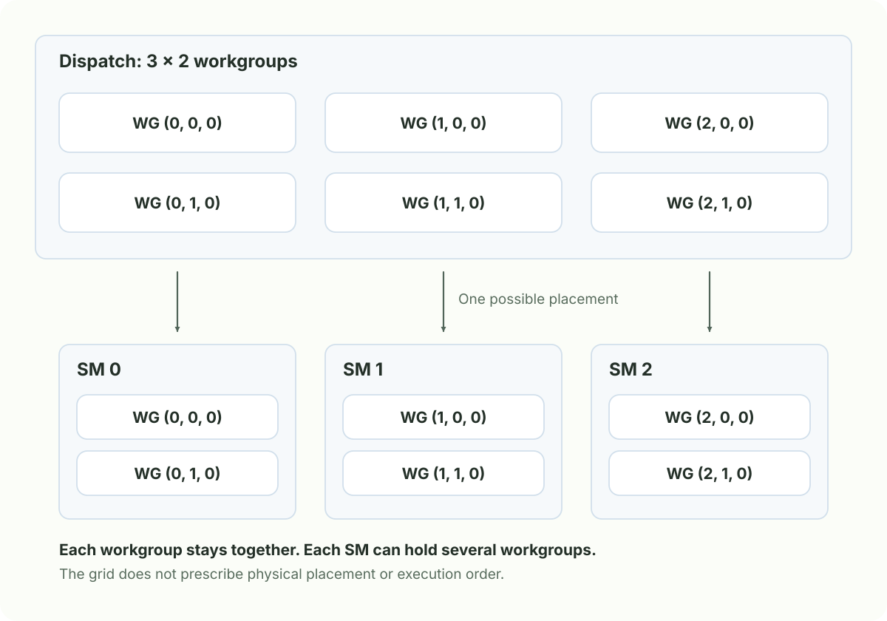
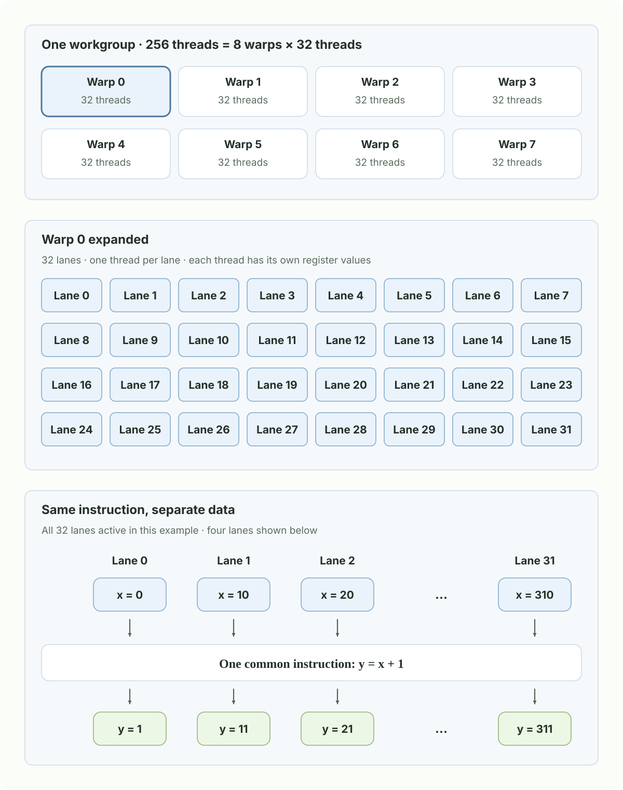
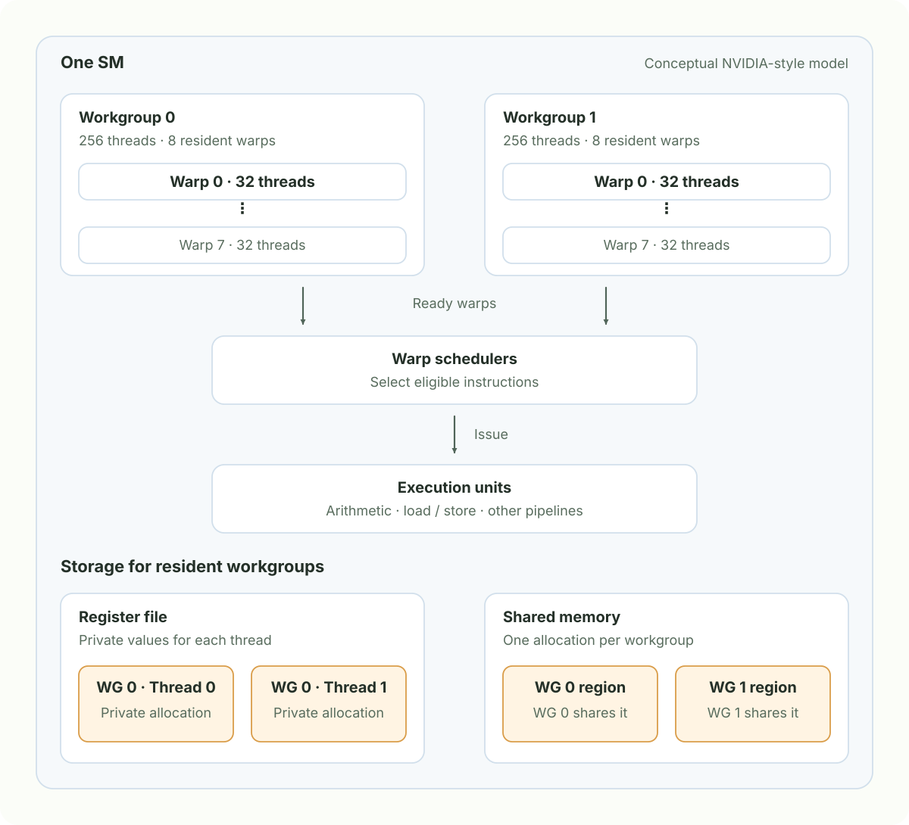
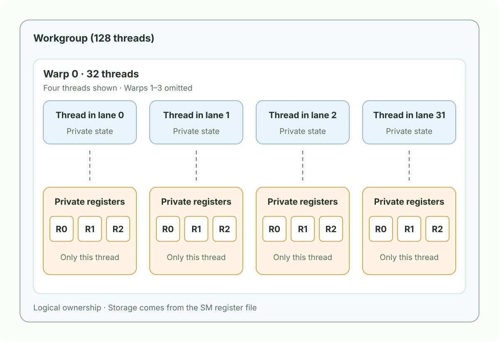
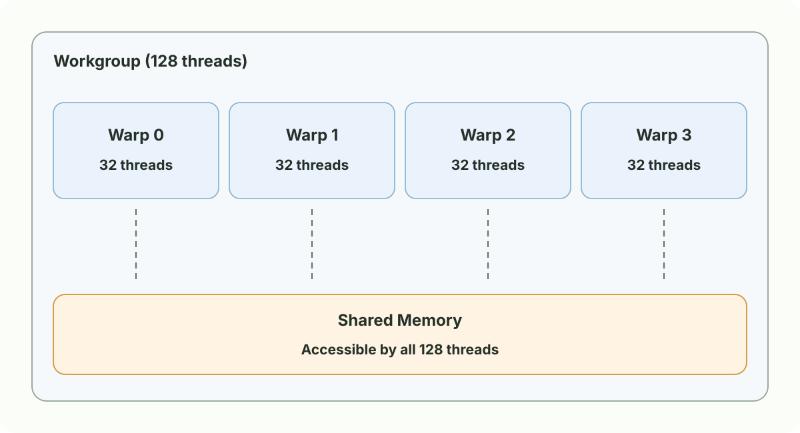
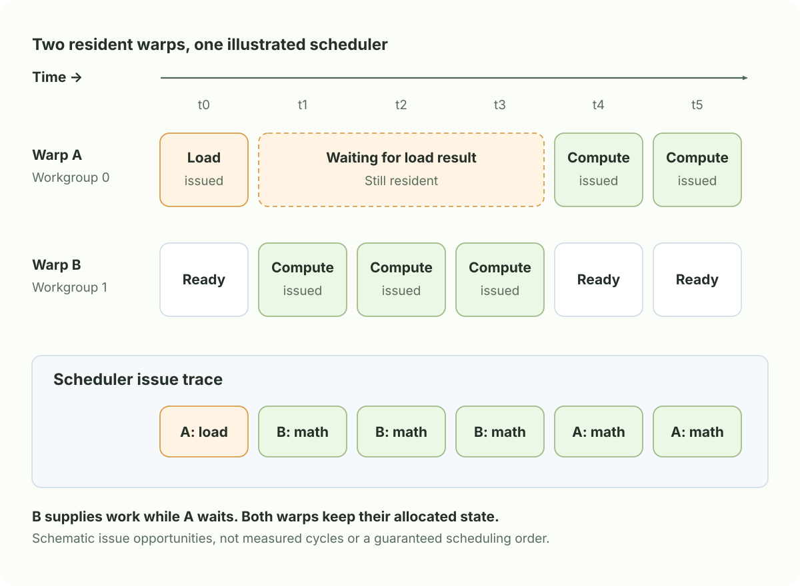
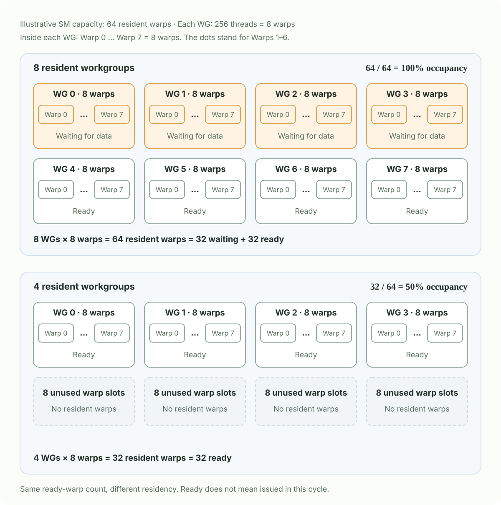
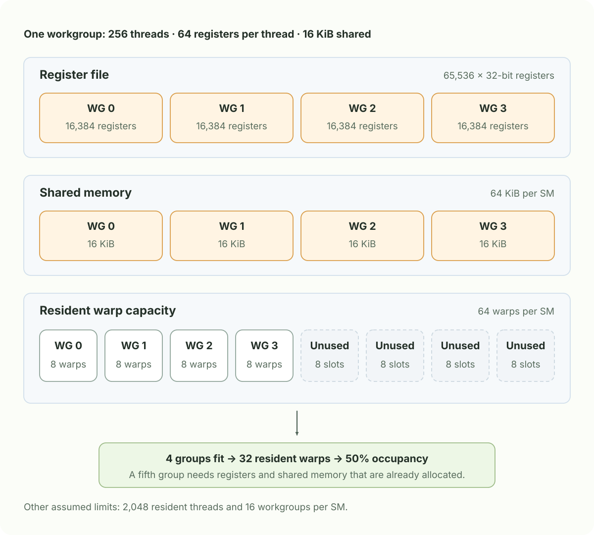

# Chapter 1: GPU Architecture

A GPU runs many instances of a program over different pieces of data. For a matrix multiplication, an instance might accumulate one output element; for image processing, it might process one pixel. Vulkan describes this work with **invocations**, **workgroups**, and **dispatches**. Understanding the hardware behind these names helps explain why changing a workgroup size can change performance.

## 1. From shader invocations to GPU hardware

| Concept | Vulkan terminology | NVIDIA terminology | AMD terminology |
| --- | --- | --- | --- |
| One shader instance | Invocation | Thread | Work-item / thread |
| A cooperating group of instances | Workgroup | Thread block | Workgroup |
| A smaller execution group | Subgroup | Warp | Wavefront / wave |
| A hardware compute block | Implementation-specific | Streaming Multiprocessor (SM) | Compute Unit (CU) |

These are useful correspondences, not identical hardware designs. Vulkan exposes a logical execution model; applications do not choose a particular SM for a workgroup.

For the **NVIDIA-style model used below**, a workgroup's threads execute on one SM, and several workgroups may reside on that SM together. Within the SM, warp schedulers issue instructions from resident warps. Workgroup placement and warp instruction scheduling are two different levels of scheduling.



Each arrow assigns whole workgroups. The placement shown is one example; Vulkan does not promise this distribution.

### What is a warp?

A **warp is a group of 32 threads** in the NVIDIA execution model. A 256-thread workgroup therefore contains eight warps. Each thread occupies one **lane** in its warp and keeps its own register values. A scheduler issues a common instruction to participating threads of a warp. This is **SIMT: Single Instruction, Multiple Threads**. See NVIDIA's [SIMT execution model](https://docs.nvidia.com/cuda/archive/13.2.0/cuda-programming-guide/03-advanced/advanced-kernel-programming.html#simt-execution-model).



The lane grid is arranged for readability; it is not a physical core layout or a Vulkan local-index mapping. In the bottom panel, all lanes participate in `y = x + 1`, but each thread reads its own `x` and produces its own `y`.

**32 threads do not imply 32 dedicated cores or one-cycle completion.** Divergent branches can leave some lanes inactive for an instruction. Modern NVIDIA GPUs also track execution state per thread, so warp membership does not remove synchronization requirements.

**Do not assume every Vulkan subgroup has 32 invocations.** Query subgroup properties and supported operations for the target device. The shader's `gl_SubgroupSize` describes its subgroup size, which can vary with the implementation and pipeline configuration. See the [Vulkan subgroup guide](https://docs.vulkan.org/guide/latest/subgroups.html).

## 2. A dispatch is a grid of workgroups

The shader declares the dimensions of **one workgroup**:

```glsl
layout(local_size_x = 8, local_size_y = 4, local_size_z = 1) in;
```

The host records the number of **workgroups** along each axis:

```cpp
// With a compatible compute pipeline and its resources bound:
vkCmdDispatch(commandBuffer, 3, 2, 1);
```

This launches six workgroups, each containing 32 invocations: 192 invocations in a global grid of size `(24, 8, 1)`. These grid coordinates organize the problem; they do not describe physical positions on the chip.


The thick outline identifies `gl_WorkGroupID`; the highlighted cell follows the same invocation between global and local coordinates. In the enlarged grid, green cells precede it in X-first order: two complete rows of eight plus three cells give `gl_LocalInvocationIndex = 19`. `gl_NumWorkGroups` counts groups, while `gl_WorkGroupSize` counts invocations along each local axis. All Z coordinates are zero.

For the invocation at local coordinate `(3, 2, 0)` inside workgroup `(1, 1, 0)`:

| GLSL built-in | Meaning | Value in this example |
| --- | --- | --- |
| `gl_WorkGroupID` | Workgroup coordinate in the dispatch | `(1, 1, 0)` |
| `gl_LocalInvocationID` | Invocation coordinate inside its workgroup | `(3, 2, 0)` |
| `gl_GlobalInvocationID` | Invocation coordinate in the global grid | `(11, 6, 0)` |
| `gl_LocalInvocationIndex` | Flattened local index, with X varying fastest | `19` |
| `gl_WorkGroupSize` | Dimensions of one workgroup | `(8, 4, 1)` |
| `gl_NumWorkGroups` | Workgroup counts in the dispatch | `(3, 2, 1)` |

The last two are sizes, not indices. The coordinate conversion is component-wise:

```glsl
uvec3 globalID = gl_WorkGroupID * gl_WorkGroupSize
               + gl_LocalInvocationID;

uint localIndex = gl_LocalInvocationID.x
                + gl_LocalInvocationID.y * gl_WorkGroupSize.x
                + gl_LocalInvocationID.z * gl_WorkGroupSize.x * gl_WorkGroupSize.y;
```

Here, the global X coordinate is `1 * 8 + 3 = 11`, and the local linear index is `3 + 2 * 8 = 19`. To flatten the **dispatch grid** into a buffer index:

```glsl
uvec3 gridSize = gl_NumWorkGroups * gl_WorkGroupSize;
uint globalIndex = gl_GlobalInvocationID.x
                 + gl_GlobalInvocationID.y * gridSize.x
                 + gl_GlobalInvocationID.z * gridSize.x * gridSize.y;
// Example: 11 + 6 * 24 = 155
```

For an image or matrix, use the actual data dimensions and row stride instead. A dispatch rounded up to cover the data may contain extra invocations, so check bounds before accessing the buffer.

Subgroups also expose `gl_SubgroupID`, `gl_SubgroupInvocationID`, and `gl_NumSubgroups`, with `GL_KHR_shader_subgroup_basic` enabled in GLSL. Use these built-ins for subgroup membership and lane IDs. Do not infer a lane ID from `gl_LocalInvocationIndex % 32`: Vulkan does not generally define that mapping. The indexing rules are specified in [Shader Interfaces](https://docs.vulkan.org/spec/latest/chapters/interfaces.html#interfaces-builtin-variables).

## 3. What lives on an SM?

**Threads describe execution state; registers and shared memory are storage resources.** A thread is not a small physical core with its own permanently attached register bank.



The figure shows two resident workgroups of 256 threads each. Each workgroup has eight warps, and the SM also contains the resources needed to keep their state:

| Resource | Ownership or role |
| --- | --- |
| Register file | Holds private values for resident threads. Different threads have different values even when executing the same instruction. |
| Shared memory | Each workgroup gets its own allocation, accessible to cooperating invocations in that workgroup. |
| Warp schedulers | Select ready warps and issue instructions to the appropriate execution pipelines. |
| Execution units | Perform arithmetic, memory operations, and other supported instructions. |
| Global memory | Stores buffers and images accessible across workgroups, subject to synchronization and visibility rules. |

The drawing is conceptual. Real SMs divide schedulers, register storage, and execution pipelines into architecture-specific subpartitions. Shared memory is explicitly managed by the shader; it is not simply an automatic cache for global memory.

### Registers belong to individual threads

The next two diagrams use a smaller **128-thread workgroup with four warps** to make storage ownership easy to see. Registers hold private per-thread values, including between threads in the same warp.



The repeated names `R0`, `R1`, and `R2` represent **different values for each thread**. The boxes show logical ownership; the storage is allocated from the SM's register file. Register names and counts here are illustrative.

Returning to the earlier **256-thread workgroup**, if compilation requires **32 registers of 32 bits per thread**, it nominally needs:

$$
R_{\mathrm{WG}} = 256 \times 32 = 8192\text{ registers}.
$$

Four such workgroups need 32,768 registers. On an illustrative SM with 65,536 registers, that is half the register capacity. Actual allocation can be rounded to hardware-specific granularity. Source-variable count does not determine register count: the compiler can eliminate values, reuse storage, or spill values into memory.

### Shared memory connects warps within a workgroup

**Shared memory is allocated per workgroup and shared by the threads in all of its warps.** In this 128-thread example, all four warps can access one shared allocation.



The dashed lines show access scope. A declaration such as `shared float tile[256];` creates one array per workgroup. Any thread in that group can access any element; the 256 elements are not assigned one-to-one to the 128 threads. Other workgroups have **separate arrays**, even when they reside on the same SM.

For a handoff between warps, one thread writes `tile[0]`, every invocation in that workgroup reaches the same `barrier()`, and a thread in another warp can then read the value. Keep this barrier in uniform control flow so that all workgroup invocations reach it. For GLSL shared variables, it supplies both the execution rendezvous and the required memory ordering for this handoff; see the [GLSL barrier specification](https://docs.vulkan.org/glsl/latest/chapters/builtinfunctions.html#barrier).

A subgroup-only barrier cannot synchronize two different warps. A workgroup barrier covers all warps in that workgroup, but does not synchronize other workgroups on the SM or elsewhere in the dispatch.

## 4. Resident, ready, and executing

Multiple workgroups can make progress concurrently on one SM, but this does not mean every thread executes an instruction in every clock cycle.

| Warp state | What it means |
| --- | --- |
| Resident / active | The warp is allocated on the SM and has not finished. |
| Ready / eligible | Its next instruction can be issued: dependencies and relevant execution resources permit it. |
| Issued | A scheduler selected an instruction from the warp for execution. |
| Stalled | The warp cannot currently issue, for example because it is waiting for a memory result or barrier. It remains resident. |



Warp A cannot issue its dependent computation until its load returns. Warp B supplies eligible instructions during the wait: this is **latency hiding**. A keeps its allocated state throughout. The timeline illustrates issue choices, not instruction durations or measured memory latency.

Scheduling is hardware-dependent; there is no guaranteed round-robin sequence over workgroups. Nor does Vulkan guarantee that distinct workgroups run together or in a chosen order. A workgroup that spins waiting for another workgroup can prevent that other group from ever being scheduled. Use an appropriate synchronization design, such as separate dispatches with the required API memory dependency, for global phases.

Within a subgroup, divergent control flow can also reduce useful execution. If lanes take different branches, paths may execute with different lane masks. Avoid assuming that sharing a subgroup replaces explicit synchronization where data exchange requires it.

## 5. Workgroup limits are not SM capacity

`maxComputeWorkGroupInvocations` limits the **total invocations in one workgroup**:

$$
L_x L_y L_z \leq \texttt{maxComputeWorkGroupInvocations}.
$$

The device also exposes separate limits:

| Vulkan limit | What it constrains |
| --- | --- |
| `maxComputeWorkGroupSize[3]` | Local size along each axis |
| `maxComputeWorkGroupCount[3]` | Workgroup count along each dispatch axis |
| `maxComputeSharedMemorySize` | Shared-memory storage used by one workgroup |

Read them from the physical device properties. For a hypothetical device reporting `maxComputeWorkGroupInvocations = 1024`, a `16 × 16 × 1` group has 256 invocations and passes the total-size limit; `32 × 32 × 1` reaches 1024; `64 × 32 × 1` exceeds it. The first two still need to satisfy the per-axis limits and other requirements. See the [Vulkan limits specification](https://docs.vulkan.org/spec/latest/chapters/limits.html).

**A limit of 1024 invocations per workgroup does not mean 1024 resident threads per SM.** The device might support several smaller workgroups on one SM. Their combined residency depends on hardware capacity and the resources consumed by the compiled shader.

## 6. Occupancy counts resident warps

Using the NVIDIA warp-based definition:

$$
\mathrm{Occupancy} =
\frac{\text{resident warps on an SM}}{\text{maximum resident warps supported by that SM}}
\times 100\%.
$$

In this metric, *active* means resident, including warps waiting for data. The tutorial introduces occupancy through resident workgroups; counting warps makes the effect of workgroup size explicit. Do not divide the resident-workgroup count by the hardware's maximum workgroup count and assume that gives warp occupancy. NVIDIA documents the distinction between active, eligible, and issued warps in its [profiling guide](https://docs.nvidia.com/nsight-compute/ProfilingGuide/index.html#sets-and-sections).

Assume an SM supports **64 resident warps**, and every workgroup contains **256 threads = 8 warps**. All capacities here are illustrative, not specifications for a particular GPU.



The first snapshot has more resident warps but the same number ready to issue. Neither ready count tells us how many instructions the SM can issue in a cycle. Even if all 64 resident warps stall, occupancy can remain 100% while no warp can issue.

### Why would only four workgroups fit?

Now give each 256-thread workgroup 64 registers per thread and 16 KiB of shared memory. The storage allocations fill up before the warp capacity does:



For example, 4,096 live `float` elements in a GLSL `shared` array require 16 KiB. The register count is twice the earlier 32-register example. Threads and warps each allow eight groups, registers and shared memory each allow four, and the hardware workgroup-count limit is sixteen:

$$
N_{\mathrm{resident\ groups}} = \min(8, 8, 4, 4, 16) = 4.
$$

$$
\mathrm{Occupancy} = \frac{4 \times 8}{64} \times 100\% = 50\%.
$$

This is a simplified resource bound assuming enough work is available, with no stricter allocation or partition constraints. Hardware allocation granularity, barriers, and other architectural limits can further reduce residency. The SM-wide shared-memory budget in this table is distinct from Vulkan's **per-workgroup** shared-memory limit.

Low occupancy can also come from too little work. A dispatch with only four workgroups cannot keep a large GPU full, but it does not imply exactly 50% occupancy: the groups may be spread over different SMs. During execution, groups also finish at different times. **Theoretical occupancy** is a resource-based ceiling; **achieved occupancy** measures residency over execution and can be lower.

## 7. What this means for LLM kernels

In [tiled GEMM](../part-3-llm-must-knows/chapter-4-gemm.md), a workgroup loads tiles into shared memory and reuses them, while each thread keeps partial sums in registers. Increasing the tile size can reduce repeated global-memory loads, but larger shared tiles or more per-thread accumulators can reduce the number of groups that fit on an SM.

The goal is useful throughput. More occupancy provides more opportunities to hide latency, but a kernel with lower occupancy can still be faster if it reuses data better or performs fewer memory accesses. Artificially restricting registers can introduce spills; shrinking shared tiles can increase global-memory traffic.

Measure kernel time alongside occupancy, scheduler activity, and memory throughput. **Occupancy describes resident execution state; bandwidth efficiency describes how effectively memory traffic serves useful work.** Both help explain performance, but neither alone determines it.
