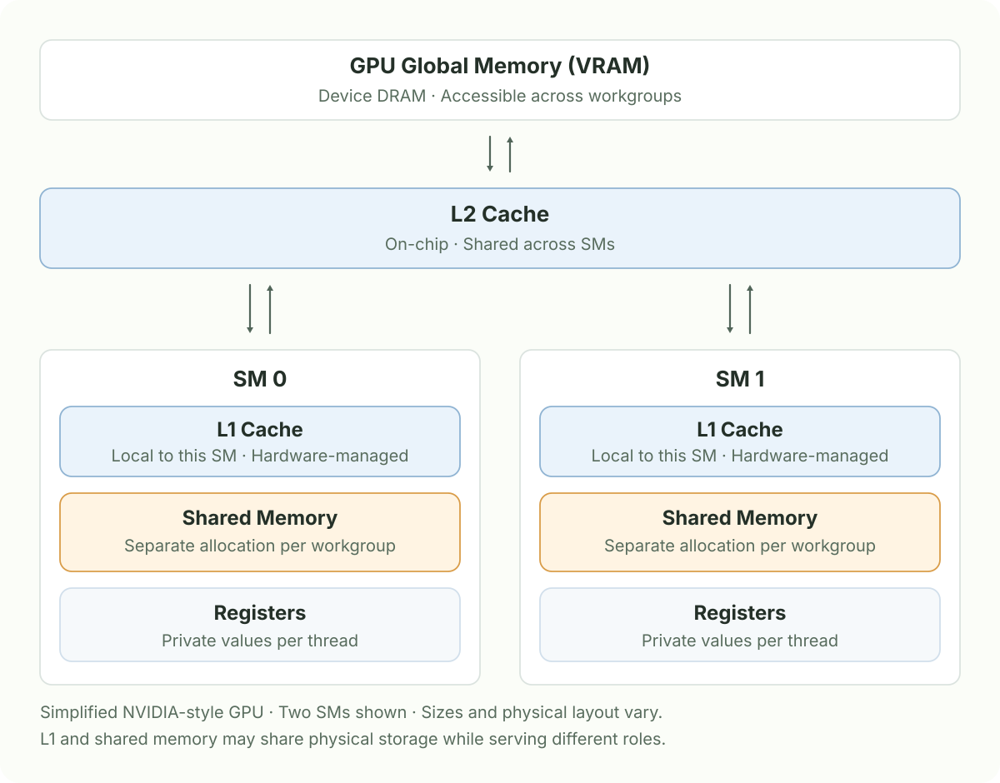
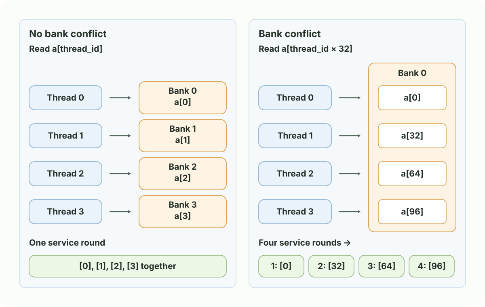
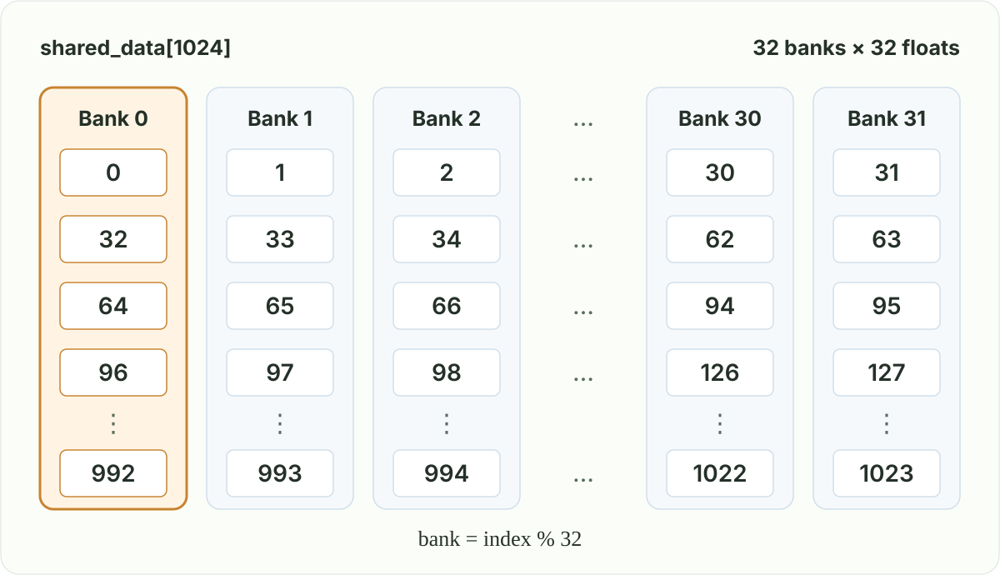

# Chapter 2: Memory Model

## 1. GPU memory hierarchy

A GPU has several places to store data. Their location and sharing scope determine which threads can use the data and how it is accessed. Start with a simplified discrete GPU, using the NVIDIA-style SM model from Chapter 1:



- **Global memory (VRAM):** Device DRAM, such as GDDR or HBM. It holds large buffers such as model weights and activations, accessible to workgroups across the GPU.
- **L2 cache:** An on-chip cache shared across SMs. A cached global-memory read can be served without fetching the data from VRAM again.
- **L1 cache:** A smaller cache local to an SM. It can serve cached accesses close to the threads executing there.
- **Shared memory:** On-chip storage explicitly used by the shader. Each workgroup gets its own allocation, shared by its threads. AMD commonly calls this [LDS (Local Data Share)](https://rocm.docs.amd.com/projects/HIP/en/develop/understand/hardware_implementation.html#local-data-share-lds).
- **Registers:** Hold private per-thread values, such as an accumulator. Each SM's register file supplies storage to its resident threads.

## 2. Shared memory: exchange data within a workgroup

```glsl
#version 450

layout(local_size_x = 256, local_size_y = 1, local_size_z = 1) in;

layout(set = 0, binding = 0) readonly buffer InputBuffer {
    float data[];
} input_buffer;

shared float shared_data[256];

void main() {
    uint local_index = gl_LocalInvocationID.x;

    // Each thread initializes its own slot in shared memory.
    shared_data[local_index] = input_buffer.data[local_index];

    // Synchronize shared memory writes across the workgroup.
    barrier();

    // Read data written by a neighboring invocation.
    float neighbor_value = shared_data[(local_index + 1) % 256];
}
```

- `shared_data` is one array shared by all 256 threads in a workgroup; each workgroup has its own array.
- Each thread copies one input value into its corresponding slot.
- `barrier()` waits for all threads in the workgroup, making their shared-memory writes safe to read.
- Each thread then reads its neighbor’s slot (255 wraps to 0), showing how shared memory lets threads exchange data.

### 2.1 Bank conflicts

Shared memory is divided into **banks** that can serve accesses in parallel. This example uses 32 banks, 32-bit floats, and an array starting at bank 0, so `bank = index % 32`. It shows four active threads of one warp; bank organization varies by GPU, and the rounds are schematic.



- **Different banks:** Reads can be served together.
- **Same bank, different words:** Reads must be split into separate rounds, causing a bank conflict.
- **Avoid conflicts:** Arrange neighboring threads to access consecutive elements when possible; `barrier()` does not change the bank mapping.
- **Same word:** Multiple threads reading the same word can use broadcast instead of conflicting in this model. [Bank mapping and broadcast rules](https://docs.nvidia.com/cuda/cuda-programming-guide/02-basics/writing-cuda-kernels.html#shared-memory).

### 2.2 GLSL example: reads with a stride of 32

Dispatch **one workgroup**, with an input buffer of at least **1,024 floats** and an output buffer of at least **32 floats**.

```glsl
#version 450

layout(local_size_x = 32, local_size_y = 1, local_size_z = 1) in;

layout(set = 0, binding = 0) readonly buffer InputBuffer {
    float data[];
} input_buffer;

layout(set = 0, binding = 1) writeonly buffer OutputBuffer {
    float data[];
} output_buffer;

shared float shared_data[1024];

void main() {
    uint thread_id = gl_LocalInvocationID.x;

    // Cooperatively initialize the entire shared array.
    for (uint i = thread_id; i < 1024; i += 32) {
        shared_data[i] = input_buffer.data[i];
    }
    barrier();

    // BANK CONFLICT HERE: threads read indices 0, 32, 64, ... (all Bank 0).
    float value = shared_data[thread_id * 32];
    output_buffer.data[thread_id] = value;
}
```

**The conflict is at `shared_data[thread_id * 32]`.** In this model, float elements are assigned to banks in a repeating pattern: indices 0–31 go to Banks 0–31, then index 32 starts again at Bank 0.



Each number is an **array index**. Read across a row for consecutive floats, or down a column for floats in the same bank. The highlighted column is exactly what `thread_id * 32` selects.

| Thread | Element read | Bank (`index % 32`) |
| --- | --- | --- |
| 0 | `shared_data[0]` | 0 |
| 1 | `shared_data[32]` | 0 |
| 2 | `shared_data[64]` | 0 |
| 3 | `shared_data[96]` | 0 |

These threads request **different words from the same bank in one warp instruction**, so Bank 0 must serve them in separate rounds. With all 32 threads participating, this is a 32-way conflict in the stated model.

The initialization loop has a different pattern: at each iteration, neighboring threads write neighboring elements (0, 1, 2, …, then 32, 33, 34, …), spreading accesses across the banks. `barrier()` ensures those writes finish before the conflicting read; it does not change where the elements are stored.
